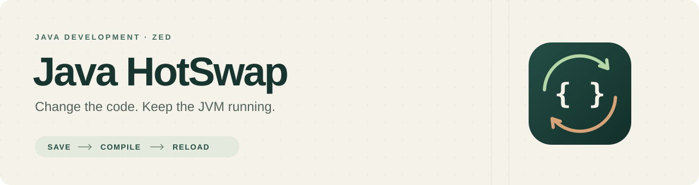

<p align="center">
  
</p>

<p align="center">
  <a href="https://github.com/xandertaylorx/java-hotswap/actions/workflows/ci.yml"></a>
  <a href="docs/validation.md"></a>
  <a href="LICENSE"></a>
  
</p>

<p align="center">
  <a href="#quick-start"><strong>Quick start</strong></a> ·
  <a href="#examples">Examples</a> ·
  <a href="docs/architecture.md">Architecture</a> ·
  <a href="docs/validation.md">Test results</a> ·
  <a href="CONTRIBUTING.md">Contributing</a>
</p>

# Java HotSwap for Zed

**Edit Java. Save. See compatible changes in the same running JVM.**

Java HotSwap connects Zed to your project's compiler and a small Java instrumentation agent. It detects supported projects, compiles saved Java changes, and automatically reloads compatible classes. Your application keeps running, and the existing Java extension continues to handle editing and diagnostics.

> [!NOTE]
> **First working release.** A one-time companion installation is required. Load the Zed extension as a dev extension; marketplace publication is pending. [Supported scope and limitations →](docs/compatibility.md)

## See the idea

Change an existing method in your application:

```diff
 static int explosionRadius() {
-    return 0;
+    return 10;
 }
```

Save the file. After compilation succeeds, the next invocation uses the new code. The console examples demonstrate this behavior:

```text
Before save:  radius=0  pid=4242
After reload: radius=10 pid=4242
```

*Illustrative output: the value changes; the JVM PID stays the same.*

## What you get

| | Behavior |
|---|---|
| **Project discovery** | Detects Gradle, Maven, and conventional plain Java projects, source directories, class outputs, and entry points. |
| **Automatic compilation** | Debounces saves and runs one build at a time. Gradle and Maven use their existing build systems. |
| **Compatible class reloads** | Reloads method bodies and logic using `Instrumentation.redefineClasses`. |
| **Failure recovery** | Compilation errors, rejected structural changes, and reload-snapshot failures leave the application running. |
| **Zed integration** | Run, Stop, Clear, and Inspect tasks, plus a native launch/output adapter. |
| **Safe runtime classpath** | Runs from a private copy of classes, resources and dependency JARs. Failed or destructive builds cannot remove files from that classpath. |
| **Build files preserved** | Uses temporary discovery/configuration files; no edits to your Gradle or Maven build files. |

There is **no automatic restart**. Structural changes are reported explicitly so you can decide when to restart.

## Quick start

### 1. Install the companion and extension

You need **Rust via rustup**, **JDK 17+**, and your project's Gradle/Maven wrapper or an installed build tool. Use a build-tool version compatible with your JDK; Gradle 9.1 supports running on Java 25. Existing Gradle toolchains are respected.

```sh
git clone https://github.com/xandertaylorx/java-hotswap.git
cd java-hotswap

cargo install --locked --path companion
rustup target add wasm32-wasip2
cargo build --locked --release --target wasm32-wasip2
```

The agent JAR is embedded in the companion, so there is no separate agent installation.

In Zed:

1. Ensure `~/.cargo/bin` is on the PATH visible to Zed, then restart Zed.
2. Run **zed: install dev extension** and select the cloned repository.
3. Keep the existing **Java** extension installed for language support and Java debugging.

### 2. Add global tasks once

```sh
java-hotswap tasks
```

Use **zed: open tasks** and add the entries from [zed-tasks.json](zed-tasks.json) to your global task array, preserving any existing tasks. They become available across your worktrees; no per-project task file is required.

### 3. Run, edit, save

1. Open a supported Java project at its build root.
2. Choose **task: spawn → Java HotSwap: Run**.
3. Edit an existing method and save.
4. Watch the compilation output and `RELOADED` messages in the task terminal.

| Task | Purpose |
|---|---|
| **Java HotSwap: Run** | Builds, starts the application with the agent, and watches Java sources. |
| **Java HotSwap: Stop** | Stops the session, including an active compilation. Ctrl-C in the Run terminal also stops it. |
| **Java HotSwap: Clear status** | Clears the active task terminal with ANSI terminal control. |
| **Java HotSwap: Inspect project** | Shows discovered directories, toolchains, modules, and entry-point candidates. |

Compilation errors retain the build tool's file/line diagnostics. Existing JDTLS provides editor diagnostics. Clear does not erase debugger output history; use Zed's output controls for that.

## Project support

| Project | Launch and compilation |
|---|---|
| **Gradle** | Java/application projects and multi-module builds. Reads main source sets and inherits the selected JavaExec task’s complete launch configuration. Uses `classes` tasks on saves. |
| **Maven** | Standard projects and reactors. Reads the effective POM and runtime dependencies. Performs an initial `package -DskipTests`, then uses `compile` on saves. |
| **Plain Java** | Conventional source layouts with a detected main method and optional extra classpath. Compiles all sources safely with `javac`. |
| **LWJGL** | Working Gradle example; inherits `-XstartOnFirstThread` on macOS. |

Java **17, 21, and 25** have been exercised on macOS Apple Silicon. An x86-64 companion was also tested under Rosetta. Linux has CI jobs configured; Windows remains experimental. Actual Intel hardware, Linux/Windows runtimes, and live Zed UI integration have not been verified locally. [Full validation record →](docs/validation.md)

> [!IMPORTANT]
> Standard JVM HotSwap rules apply. Changing method code does not rerun initializers or update values already stored in objects. Field/method additions, inheritance changes, and other structural edits may require a manual restart. Custom launchers, Android, module-path applications, and composite Gradle builds are outside automatic support in this release. [Compatibility details →](docs/compatibility.md)

## Examples

Each console example prints an explosion radius and its JVM PID, making reloads easy to observe.

| Example | What it demonstrates |
|---|---|
| [Plain Java](examples/plain) | A minimal project with no build tool. |
| [Destructive Gradle build](examples/destructive-gradle) | Deletes class/resource/JAR outputs during compilation; verifies failure isolation and same-process recovery. |
| [Custom JavaExec](examples/javaexec) | Required arguments, preparation tasks, environment, working directory, JVM settings, and extra runtime resources. |
| [Gradle](examples/gradle) | Application detection and an external runtime dependency. |
| [Maven](examples/maven) | POM discovery and an external runtime dependency. |
| [Gradle multi-module](examples/gradle-multi) | Reloading a class in a dependency module. |
| [Maven multi-module](examples/maven-multi) | Reactor dependencies launched from class directories. |
| [LWJGL](examples/lwjgl) | A GLFW window whose title changes after a method reload. |
| [Nested Gradle](examples/nested-gradle) | Open the parent folder; the `java/` build uses its wrapper, LWJGL, Gson, and `build.nosync`. |

For a first try, open `examples/plain` in Zed and run **Java HotSwap: Run**. Change `return 0;` to `return 10;`, then save.

## Configuration and debugging

Gradle launches through an existing JavaExec task, including the application plugin’s `run` task. A single task is selected automatically; multiple tasks require `gradleRunTask`. Maven and plain Java detect conventional `public static void main(String[] args)` entry points; multiple candidates require an explicit selection.

### Workspaces with nested Java builds

Open your workspace normally. Discovery searches subdirectories for Gradle (Groovy/Kotlin) and Maven builds. A single build is selected automatically, so `minecraftclone/java/build.gradle` works with Zed opened at `minecraftclone`. The selected root and build executable appear in the output. Gradle's wrapper compiles the sources; Gradle supplies the resolved runtime classpath, actual output directories (including custom `build.nosync`), application main class, and JVM arguments. Build failures are reported without falling back to bare `javac`.

If the workspace contains several independent builds, discovery lists them and requires a selection before executing a build. Set `projectRoot` in each Zed launch scenario:

```json
[
  {
    "label": "Game HotSwap",
    "adapter": "Java HotSwap",
    "request": "launch",
    "cwd": "$ZED_WORKTREE_ROOT",
    "projectRoot": "java"
  }
]
```

The CLI equivalent is `java-hotswap run --project /path/to/workspace --project-root java`. You can also set `projectRoot` in the workspace's `.java-hotswap.json`. Gradle subprojects and Maven reactor modules belong to their enclosing build; use `module` to select an application within that build. To run separate sessions concurrently, set each scenario's `cwd` to its own build root so session locks and Stop/Clear controls are independent.

Discovery skips symlinks and generated/cache directories such as `.git`, `.gradle`, `.java-hotswap`, `build`, `build.nosync`, `target`, and `node_modules`. Use an explicit `projectRoot` for a build in an excluded directory. Plain Java compilation is used only when no build is found; an invalid explicit build selection produces an error.

### Build timing and incremental compilation

Every build reports task paths, durations and outcomes (`EXECUTED`, `UP-TO-DATE`, `FROM-CACHE`, `SKIPPED`, `FAILED`). HotSwap also reports changed/source file counts, source scan/debounce time, build wall time, reload snapshot bytes/classes, and agent hash/redefinition time. Discovery, launch preparation and runtime copying have separate startup timings. Maven/plain Java retain their normal compilers and receive build/reload phase timings.

For Gradle’s detailed input-change reasons and incremental class counts, add this to your existing Zed launch scenario or `.java-hotswap.json`, then restart the session:

```json
"buildDiagnostics": true
```

This enables Gradle `--info` on compilation commands. Look for `Incremental compilation of ... classes`, `Full recompilation is required ...`, missing outputs, changed compiler arguments, annotation processing and task input changes. It is opt-in because normal Gradle verbose output can include project-configured values. Task timings do not print application arguments, environment or system properties.

Rebuilds honour the project’s daemon, compiler/toolchain, incremental, build-cache and configuration-cache settings. HotSwap requests the selected application’s main classes tasks plus modules present in its resolved runtime classpath; Gradle follows their normal dependencies. Unrelated modules are not requested. Discovery and run-task capture still disable configuration caching because they inspect mutable Gradle models and launch preparation.

Incremental does not mean “compile one file”: a change can affect a large dependency closure within one source set. HotSwap never limits javac to the edited file, overrides annotation processors, forces caching or removes preparation tasks. See the [measured performance investigation](docs/performance.md) for a large-project example and how to interpret the timings.

### Compilation failures and runtime isolation

After the initial build and run-task preparation succeed, HotSwap copies the resolved launch classpath into `.java-hotswap/runtime`. This includes class directories, resources and dependency JARs; the JVM and agent use those private paths. Gradle/Maven continue compiling through their normal task graphs into their normal outputs, separate from the running JVM’s classpath. Even a task that deletes those outputs cannot remove the runtime’s files.

Only a successful build publishes an immutable reload generation. Failed compilation leaves the prior method definitions and runtime files intact. Runtime files are kept for the entire JVM lifetime and removed after it stops; reload-generation pruning never touches them. Startup needs enough disk space for a full classpath copy and stops if copying fails.

The runtime copy preserves launch-time resources, dependency versions and class bytes. HotSwap redefines compatible **already loaded project classes** after successful builds. Classes first loaded later use their launch-time bytes; new classes, resource/dependency changes and changes to the launch configuration require a manual restart. Application files accessed through the working directory remain under the project’s control.

### Gradle run configurations

HotSwap inherits the selected JavaExec task’s application arguments, JVM arguments and argument providers, system properties, working directory, environment, runtime classpath, and Java executable/toolchain. Task dependencies and `doFirst` preparation execute before capture, so arguments calculated from generated files are included. The companion then launches that configuration with the HotSwap agent and keeps automatic reloads active.

If a build has several run tasks, select one in your Zed debug scenario:

```json
{
  "label": "Client HotSwap",
  "adapter": "Java HotSwap",
  "request": "launch",
  "cwd": "$ZED_WORKTREE_ROOT",
  "gradleRunTask": ":runClient"
}
```

Use the task path listed in the selection error or Inspect output. The CLI equivalent is `java-hotswap run --project /path/to/project --gradle-run-task :runClient`. Subproject paths such as `:app:run` are supported. HotSwap does not invent required arguments or credentials. Without a usable JavaExec configuration, launch stops with an explanation of what is missing.

Additional HotSwap `args` and `jvmArgs` are appended to the inherited arguments. An explicit `javaHome` overrides the task’s Java launcher; leave it unset to preserve the toolchain. A `mainClass` override must match the selected task.

Capture supports standard classpath JavaExec tasks. Custom JavaExec subclasses, Exec/script launchers, executable JARs and module-path launches are outside this support. Task `doLast` actions and finalizers are not replayed when the companion-owned JVM stops; choose a task that does not require those cleanup actions. Launch values use a temporary private metadata file, removed after capture, and are excluded from persistent discovery metadata.

### Gradle and Java compatibility

HotSwap reads `gradle/wrapper/gradle-wrapper.properties` before starting the wrapper and checks the [Gradle runtime compatibility matrix](https://docs.gradle.org/current/userguide/compatibility.html). For example, Gradle 8.10 supports runtime Java 8–23; Java 25 support starts with Gradle 9.1. If your default JDK is incompatible, HotSwap selects a compatible installed JDK for Gradle. Gradle still selects the application's compiler and launcher through its toolchain configuration. The wrapper and build files are never upgraded or rewritten.

JDK discovery checks `JAVA_HOME`, PATH, platform installation directories on macOS/Linux/Windows, Homebrew, SDKMAN, asdf, Jabba, user `.jdks`, and Gradle's downloaded JDKs. Windows JavaSoft registry entries are also checked. Additional installation roots can be supplied with `JAVA_HOTSWAP_JDK_PATHS` (a platform-separated path list). A JDK must contain Java, javac and release metadata, and the selected executable must start successfully. Early-access JDKs are excluded from automatic selection.

Use `gradleJavaHome` only when you want to select the build JDK explicitly; `javaHome` remains the application JDK override. Existing `org.gradle.java.home` settings are validated and respected unless explicitly overridden by `gradleJavaHome`. Gradle daemon JVM criteria keep their normal precedence and vendor selection; incompatible requested runtime versions produce an actionable error. If no compatible JDK is installed, HotSwap tells you the supported range and how to provide a build JDK before executing build scripts.

Versioned distributions on custom hosts are accepted, then checked against the wrapper's actual `--version` output and reported launcher JVM. Unversioned/custom distribution names require a verified `gradleVersion` in the HotSwap configuration. Mismatches and unrecognized version/JVM output stop preflight. No build scripts are used to guess the version. Stable Gradle 7.3–9.8.1 is covered by the embedded table; prereleases and versions outside that table require an extension compatibility update.

<details>
<summary><strong>Choose an entry point or customize JVM arguments</strong></summary>

Create `.java-hotswap.json` in the workspace (`cwd`) only when needed:

```json
{
  "mainClass": "demo.Main",
  "module": ":app",
  "jvmArgs": [],
  "args": [],
  "debounceMs": 250
}
```

| Option | Use |
|---|---|
| `projectRoot` | Gradle/Maven build root, absolute or relative to the workspace. Required when several independent builds are discovered. |
| `mainClass` | Fully qualified entry point for Maven/plain Java; must match a selected Gradle task. |
| `gradleRunTask` | Gradle JavaExec task path, e.g. `:app:run`; required when several tasks exist. |
| `module` | Gradle project path or absolute Maven module directory; Inspect shows the exact value. |
| `javaHome` | Select a JDK; relative paths resolve from the workspace. Otherwise uses Gradle's application launcher or `JAVA_HOME`/PATH. |
| `gradleJavaHome` | Explicit compatible Gradle runtime JDK; independent of the application's `javaHome` and toolchains. Relative paths resolve from the workspace. |
| `gradleVersion` | Verified stable version for custom/unversioned Gradle distributions or launchers; checked against actual wrapper output. |
| `jvmArgs` | Additional JVM arguments, such as `-XstartOnFirstThread` for a macOS application that needs it. |
| `args` | Application arguments; appended to inherited Gradle task arguments. |
| `buildDiagnostics` | Opt-in Gradle `--info` compiler/rebuild reasons; phase and task timings are always enabled. |
| `buildArgs` | Build-tool options, such as Maven profiles. |
| `classpath` | Additional directories/JARs for plain Java. |
| `debounceMs` | Save debounce interval; defaults to 250 ms. |
| `jdwpPort` | Optional loopback debugger port for Java attach. |

For Gradle, select `gradleRunTask` to choose a module and launch configuration. Maven/plain entry overrides can use `module` and `mainClass`. The LWJGL example declares the macOS first-thread argument in its Gradle application configuration.

Unknown fields fail explicitly. Stop and start the session after changing build configuration so the project is rediscovered.

</details>

<details>
<summary><strong>Use Zed's native launch/output UI</strong></summary>

Add a scenario to your project's `.zed/debug.json` array:

```json
{
  "label": "Run with Java HotSwap",
  "adapter": "Java HotSwap",
  "request": "launch",
  "cwd": "$ZED_WORKTREE_ROOT"
}
```

Choose **debugger: start**. Closing the session stops the application.

This adapter manages launching, output, and stopping. It reports breakpoints as unverified; use the existing Java adapter for stepping and breakpoints. Automatic Java gutter scenario generation is not implemented, and live Zed UI testing remains outstanding.

</details>

<details>
<summary><strong>Attach the existing Java debugger</strong></summary>

Add `"jdwpPort": 5005` to `.java-hotswap.json`, start HotSwap, and launch an existing Java extension attach scenario:

```json
{
  "label": "Attach Java debugger",
  "adapter": "Java",
  "request": "attach",
  "hostName": "127.0.0.1",
  "port": 5005
}
```

JDWP binds to loopback. Live Zed Java attach has not been verified here. Avoid another tool simultaneously redefining the same classes.

</details>

## Development

```sh
cargo fmt --check
cargo fmt --manifest-path companion/Cargo.toml --check
cargo clippy --all-targets -- -D warnings
cargo clippy --manifest-path companion/Cargo.toml --all-targets -- -D warnings
cargo test --manifest-path companion/Cargo.toml
cargo build --manifest-path companion/Cargo.toml
python3 tests/e2e.py -v
cargo build --locked --release --target wasm32-wasip2
```

The end-to-end tests start real JVMs, edit real source files, and assert changed output **with the same PID**. They also cover compilation failures, structural-change rejection, recovery, duplicate sessions, saves during compilation, cancellation, DAP shutdown, and snapshot-publication errors.

Gradle and Maven must be on PATH, or supplied through `JAVA_HOTSWAP_GRADLE` and `JAVA_HOTSWAP_MAVEN` as absolute paths. CI defines macOS/Linux × Java 17/21/25 jobs; see the workflow badge for current GitHub results and [validation.md](docs/validation.md) for executed local results.

Run the graphical test on an active desktop:

```sh
JAVA_HOTSWAP_TEST_LWJGL=1 python3 tests/e2e.py HotSwap.test_lwjgl -v
```

Headless CI skips that test. Add `.java-hotswap/` to your own project's ignore rules to hide generated session data; the tool never edits your ignore file.

## Documentation

| Guide | Contents |
|---|---|
| [Architecture](docs/architecture.md) | Project discovery, compilation, immutable reload snapshots, and process ownership. |
| [API research](docs/api-research.md) | Official Zed capabilities and the supported integration choices. |
| [Compatibility](docs/compatibility.md) | Build-system, JVM, and platform boundaries. |
| [Validation](docs/validation.md) | Executed checks and unverified environments. |
| [Publication](docs/publishing.md) | Marketplace prerequisites and release workflow. |
| [Contributing](CONTRIBUTING.md) | Development expectations and testing new integrations. |

---

**MIT licensed.** See [LICENSE](LICENSE). Contributions and reproducible bug reports are welcome through [GitHub issues](https://github.com/xandertaylorx/java-hotswap/issues).
